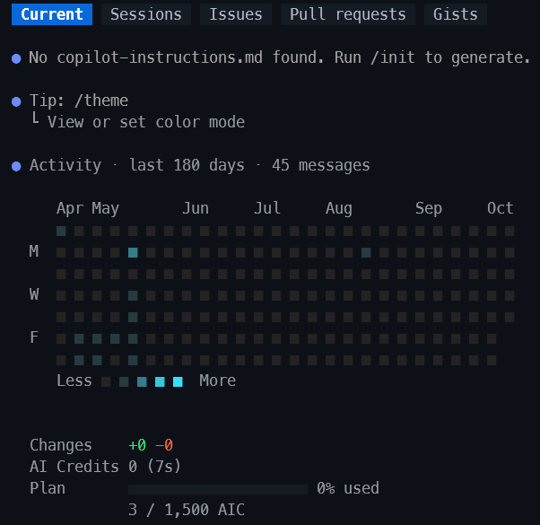
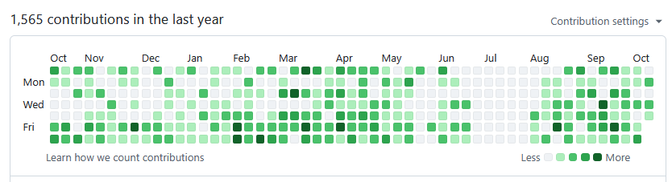
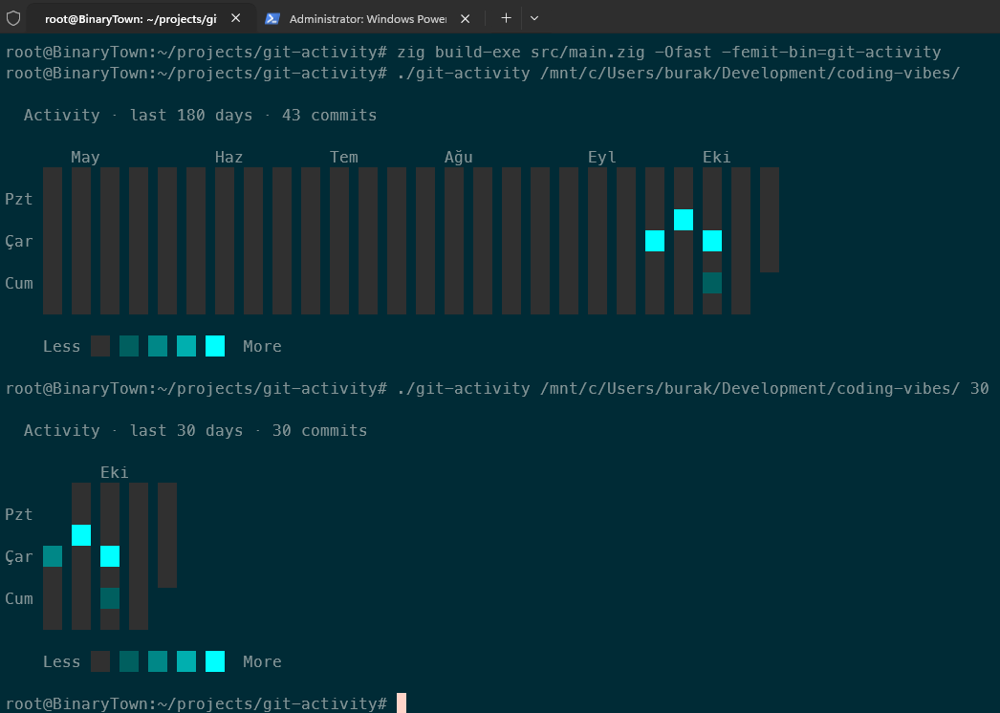
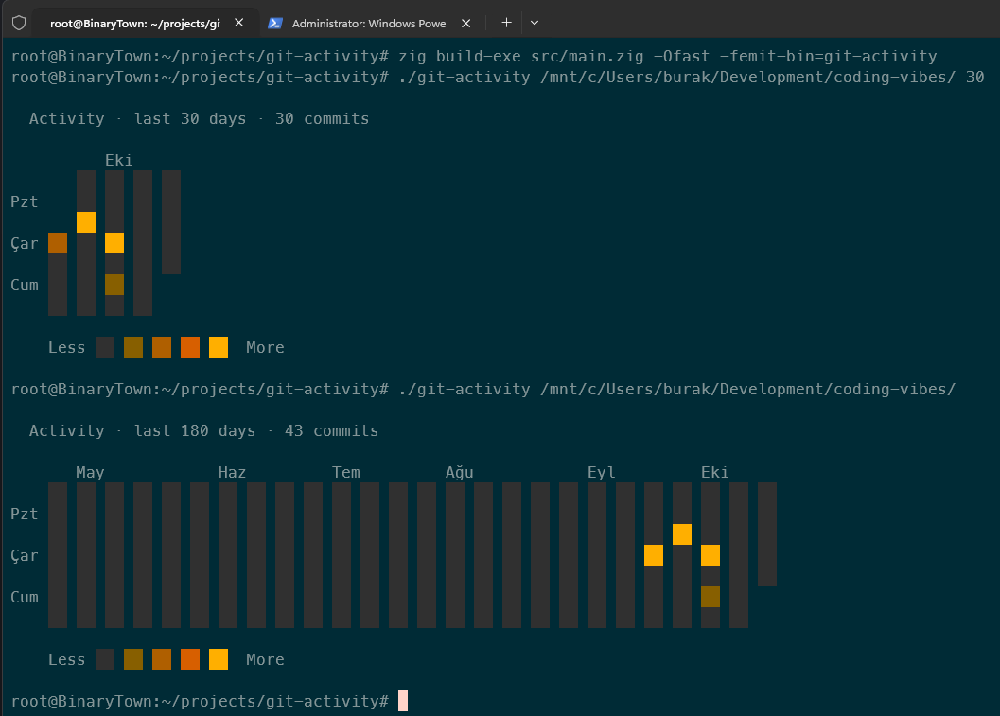

# Git Activity Dashboard

Copilot CLI ile çalıştığım bir gün `/usage` komutu ile geçmiş aktivitilerimi görüntülemiştim.



Aslında benzer bir görünüm hepimizin bildiği üzere github profil sayfalarımızda da oluyor. Geçmişe yönelik olarak günlük commit sayılarımıza göre yeşil rengin tonları da değişiyor.



Bunun üzerine benzer şeyi terminalde gösteren ve local repo'larda çalışan çok basit bir CLI aracını Zig dili ile yazabilir miyim diye düşünmeye başladım. Çok az bir zamanda olsa Zig programlama diline bakmıştım ama hiçbir şeyi hatırlamıyordum. Bu yüzden GPT'den bir öğreti hazırlamasını istedim. İşte buradaki örnek [o öğretinin](./docs/zig-git-activity-tutorial.md) bir sonucu.

## Kurulum ve Kullanım

Öğretiyi hazırlarken Zig dilinin son stabil sürümünü kullanmasını, C# ve Rust tecrübem olduğu için kullanılan materyallerin bu dillerle karşılaştırılmasını, örneği Windows ortamında WSL üzerinden çalıştırmayı hedeflediğimi belirttim.

İlk sürüm tarih hesabı için GNU `date` komutunu kullandığından yalnızca Linux/WSL üzerinde çalışıyordu. Bu repodaki sürüm tarihi `git var GIT_COMMITTER_IDENT` çıktısından (yerel saat dilimiyle) hesaplar, argümanları Windows'ta da çalışan şekilde okur ve Windows konsolunda UTF-8 + ANSI renkleri açar. Böylece Windows, Linux ve macOS'ta doğrudan çalışır. Tek gereksinim `PATH` üzerinde `git` olmasıdır.

### Hazır sürüm

[Releases](https://github.com/buraksenyurt/git-dash/releases/latest) sayfasından platformunuza uygun tek dosyalık binary'yi indirebilirsiniz (`windows-x64`, `windows-arm64`, `linux-x64`, `linux-arm64`, `macos-x64`, `macos-arm64`). [my-tool-set](https://github.com/buraksenyurt/my-tool-set) kabuğu da aracı buradan kurar.

### Kaynaktan derleme (Zig 0.17.0)

```bash
# Testler
zig build test

# Derleme (çıktı: zig-out/bin/git-dash)
zig build -Doptimize=ReleaseSafe

# Derleyip çalıştırma
zig build run -- ~/projects/my-rust-project 60
```

### Kullanım

```text
git-dash [repo-yolu] [gun-sayisi]
```

```bash
# Varsayılan: bulunduğun klasör, 180 gün
git-dash

# Belli bir repo, son 60 gün
git-dash ~/projects/my-rust-project 60
```

```powershell
# Windows
git-dash.exe C:\Users\burak\Development\my-tool-set 90
```

### Sürüm çıkarmak

`build.zig.zon` içindeki `.version` değerini güncelleyip aynı sürümle bir tag atmak yeterli; `release` iş akışı tüm platformlar için çapraz derleme yapar ve `release.json` ile birlikte yayınlar.

```bash
git tag -m "v0.1.0" v0.1.0
git push origin v0.1.0
```



Birde farklı renk paleti uygulanmış hali.


